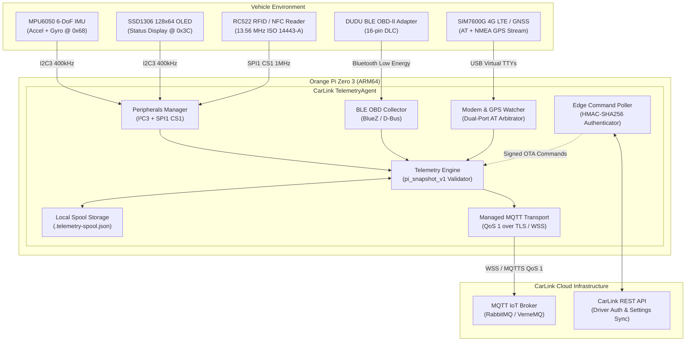

# CarLink `TelemetryAgent` (Orange Pi Zero 3)

The **CarLink `TelemetryAgent`** is an edge telemetry and diagnostics agent designed for the **Orange Pi Zero 3** (Allwinner H618 Quad-core Cortex-A53 ARM64). It collects real-time vehicle telemetry, driving dynamics, GNSS location, cellular metrics, and driver authentication badges, streaming schema-validated `pi_snapshot_v1` frames to the CarLink SaaS platform over secure MQTT QoS 1.



---

## Key Capabilities

1. **Cellular & GNSS Telemetry (`SIM7600G`)**:
   - Automatic Linux `/proc/*/fd` and `ModemManager` (`mmcli`) inspection to identify which USB port is locked by ModemManager.
   - Binds directly to the **secondary AT command port** to eliminate serial command collision and timeouts.
   - Simultaneously consumes independent USB NMEA streams (`/dev/ttyUSB1`) for 1 Hz GPS coordinates, elevation, speed, and satellite fix.
2. **Vehicle Diagnostics & Fuel Monitoring (`DUDU BLE OBD-II`)**:
   - Asynchronous, non-blocking BLE link via BlueZ and D-Bus.
   - Ingests engine RPM, vehicle speed, coolant temperature, intake air temperature, MAF, and calculated fuel consumption rate (L/h and L/100km).
   - Scans diagnostic trouble codes (DTCs) and alerts on MIL / check engine lamp illumination.
3. **Driving Dynamics & Visual Dashboard (`MPU6050` + `SSD1306 OLED`)**:
   - Samples 3-axis accelerometer and 3-axis gyroscope over I²C3 at 5 Hz.
   - Computes real-time acceleration, harsh braking, rapid acceleration, and sharp cornering events against cloud-synced thresholds.
   - Renders a live 6-line diagnostic status screen on the 128×64 OLED display.
4. **Driver Authentication (`RC522 RFID/NFC`)**:
   - Reads driver RFID/NFC badges via SPI1 CS1 (`/dev/spidev1.1`).
   - One-way hashes raw badge UIDs with SHA-256 before verification over HTTPS REST, keeping raw badge serials off the wire.
5. **Zero-Loss Spooling & Resilient MQTT Protocol**:
   - Publishes `pi_snapshot_v1` packets over TLS-secured WebSockets or MQTTS with MQTT 3.1.1 QoS 1.
   - Local on-disk write-ahead spooling (`.telemetry-spool.json`) guarantees zero telemetry loss during cellular dead zones.
   - Remote HMAC-SHA256 authenticated edge command polling every 5s with dynamic OTA settings synchronization.

---

## Hardware Pinout & Wiring

The TelemetryAgent uses the Orange Pi Zero 3's 26-pin expansion header, USB host, and wireless Bluetooth Low Energy.

### 1. 26-Pin Header Pinout

| Pin | Function / Overlay | Device Connection | Notes |
|:---:|:---|:---|:---|
| **1** | `3.3V Power` | MPU6050 `VCC`, SSD1306 `VCC` | Shared 3.3V rail |
| **3** | `I2C3_SDA` (`ph-i2c3`) | MPU6050 `SDA`, SSD1306 `SDA` | Shared I²C bus with 4.7kΩ pull-ups |
| **5** | `I2C3_SCL` (`ph-i2c3`) | MPU6050 `SCL`, SSD1306 `SCL` | Shared I²C bus clock |
| **9** | `GND` | Common Ground | Ground return |
| **17** | `3.3V Power` | RC522 `3.3V` | **Do not connect RC522 to 5V!** |
| **19** | `SPI1_MOSI` (`spi1-cs1-spidev`) | RC522 `MOSI` | SPI Master Out Slave In |
| **21** | `SPI1_MISO` (`spi1-cs1-spidev`) | RC522 `MISO` | SPI Master In Slave Out |
| **23** | `SPI1_SCLK` (`spi1-cs1-spidev`) | RC522 `SCK` | SPI Clock |
| **25** | `GND` | RC522 `GND` | Ground return |
| **26** | `SPI1_CS1` (`spi1-cs1-spidev`) | RC522 `SDA / NSS` | Chip Select 1 (`/dev/spidev1.1`) |
| **22** | `GPIO` (Reset) | RC522 `RST` | Hardware reset pin |

### 2. USB & Wireless Peripherals

- **SIM7600G 4G LTE / GNSS Module**:
  - Connect via micro-USB cable to the Orange Pi Zero 3 USB host port.
  - Connect external LTE antennas to the `MAIN` and `AUX` SMA ports.
  - Connect active GPS patch antenna to the `GPS` SMA port.
- **DUDU BLE OBD-II Scanner**:
  - Plug directly into vehicle 16-pin OBD-II port (under dashboard / steering column).
  - Pairs wirelessly with the Orange Pi Zero 3 onboard Bluetooth 5.0 controller.

---

## Vehicle Plate Configuration

The CarLink platform maps all telemetry frames to registered fleet vehicles by their license plate.

> [!IMPORTANT]
> The registered vehicle plate (for example, **`ABC 1234`**) must be supplied when commissioning the agent. The plate is automatically normalized (spaces and special characters stripped, converted to uppercase: `ABC 1234` → `ABC1234`) and stored in `.telemetry-state.json` (permission mode `0600`).
>
> Once saved, subsequent runs and systemd background services boot automatically without requiring any flags.

You can supply the vehicle plate through any of the following methods:

1. **Command Line Argument**:
   ```bash
   sudo ./release/carlink-telemetry-agent --plate "ABC 1234"
   # or with node:
   sudo node index.js --plate "ABC 1234"
   ```
2. **Environment Variable**:
   ```bash
   export CARLINK_PLATE="ABC 1234"
   sudo -E ./release/carlink-telemetry-agent
   ```
3. **Commissioning File (`carlink-device.json`)**:
   Add the `"plate": "ABC 1234"` field directly to your `carlink-device.json` file.

---

## Device Commissioning Configuration

The agent requires a commissioning file containing device-specific credentials generated by the CarLink SaaS console.

Create `carlink-device.json` in the agent directory (or copy from `carlink-device.example.json`):

```bash
cp carlink-device.example.json carlink-device.json
chmod 600 carlink-device.json
```

### Configuration Format (`carlink-device.json`)

```json
{
  "device_id": "00000000-0000-0000-0000-000000000001",
  "organization_id": "00000000-0000-0000-0000-000000000001",
  "obd_uuid": "00000000-0000-0000-0000-000000000001",
  "obd_bluetooth_mac": "11:22:33:44:55:66",
  "api_url": "https://api.carlink.example.com",
  "broker_url": "wss://broker.carlink.example.com/ws",
  "broker_username": "d-00000000000000000000000000000001",
  "auth_token": "0123456789abcdef0123456789abcdef0123456789abcdef0123456789abcdef",
  "plate": "ABC 1234"
}
```

### Field Definitions

| Field | Type | Description |
|:---|:---:|:---|
| `device_id` | `UUIDv4` | Unique hardware device identifier assigned in CarLink SaaS console. |
| `organization_id` | `UUIDv4` | Tenant organization UUID owning this vehicle and device. |
| `obd_uuid` | `UUIDv4` | Paired OBD hardware entity UUID. |
| `obd_bluetooth_mac` | `String` | Bluetooth MAC address of DUDU BLE OBD adapter (`AA:BB:CC:DD:EE:FF`). |
| `api_url` | `String` | CarLink REST API base URL (`https://...`). |
| `broker_url` | `String` | Secure MQTT broker endpoint (`wss://.../ws` or `mqtts://...:8883`). |
| `broker_username` | `String` | MQTT client username format: `d-<device_id_without_dashes>`. |
| `auth_token` | `Hex64` | 64-character SHA-256 HMAC shared secret and Bearer token. |
| `plate` | `String` | *(Optional)* Default vehicle license plate (e.g. `ABC 1234`). |

> [!CAUTION]
> `carlink-device.json` contains private device authentication tokens. It is explicitly ignored in `.gitignore` and should never be checked into version control. Ensure it is protected with `chmod 600`.

---

## Linux ARM64 Executable (Under `release/`)

A standalone, self-contained **Linux ARM64 ELF executable** is packaged under `release/`:

```
release/
├── carlink-telemetry-agent             # Standalone Linux aarch64 ELF binary
├── carlink-telemetry-agent-linux-arm64 # Identical binary with architecture tag
└── SHA256SUMS                          # Cryptographic verification checksums
```

### Running the Standalone Executable on Orange Pi Zero 3

The standalone release binary includes an embedded Node.js runtime and bundled agent logic. It does not require a globally installed Node.js version on the target board:

```bash
cd /opt/carlink/TelemetryAgent

# 1. Grant execute permissions
chmod +x release/carlink-telemetry-agent

# 2. Verify binary integrity
cd release && sha256sum -c SHA256SUMS && cd ..

# 3. First run: provide vehicle plate (e.g. ABC 1234)
sudo ./release/carlink-telemetry-agent --plate "ABC 1234"

# 4. Subsequent automatic runs (reads saved plate from .telemetry-state.json)
sudo ./release/carlink-telemetry-agent
```

### Building the Linux ARM64 Executable from Source

To compile or rebuild the standalone Linux ARM64 executable:

```bash
cd Pi/TelemetryAgent

# Install dependencies
npm install

# Build release executable targeting linux-arm64
npm run build:linux-arm64
```

This compiles `release/carlink-telemetry-agent` and generates `release/carlink-telemetry-agent-linux-arm64`.

---

## Setup & Installation on Orange Pi OS

### 1. OS & Device Tree Configuration

1. Install **Armbian Linux** or **Orange Pi OS** (Debian 12 / Ubuntu 22.04/24.04 ARM64).
2. Enable I²C3 and SPI1 device tree overlays:
   - Run `sudo orangepi-config` (or `sudo armbian-config`).
   - Navigate to **System** → **Hardware** and enable `ph-i2c3` and `spi1-cs1-spidev`.
   - Alternatively, edit `/boot/orangepiEnv.txt` or `/boot/armbianEnv.txt`:
     ```ini
     overlays=ph-i2c3 spi1-cs1-spidev
     ```
   - Reboot the board: `sudo reboot`.
3. Verify device nodes exist:
   ```bash
   ls -l /dev/i2c-3 /dev/spidev1.1
   ```

### 2. System Packages & Permissions

Install required system utilities:

```bash
sudo apt update && sudo apt install -y \
  bluetooth \
  bluez \
  modemmanager \
  i2c-tools \
  curl
```

Grant current user access to hardware buses (if not running strictly as root):

```bash
sudo usermod -aG dialout,i2c,bluetooth $USER
```

### 3. Deploying TelemetryAgent

```bash
# Recommended production directory
sudo mkdir -p /opt/carlink
sudo cp -r Pi/TelemetryAgent /opt/carlink/
cd /opt/carlink/TelemetryAgent

# Copy your provisioning credentials
sudo cp /path/to/downloaded/carlink-device.json /opt/carlink/TelemetryAgent/carlink-device.json
sudo chmod 600 /opt/carlink/TelemetryAgent/carlink-device.json

# If running via Node:
npm install --omit=dev
```

---

## Hardware Verification & Diagnostic Tools

Before starting the full telemetry agent, run the built-in diagnostic suite to confirm all hardware buses are responding:

### 1. Inspect Serial & Modem Ports

```bash
node index.js ports
# or with release binary:
./release/carlink-telemetry-agent ports
```
*Inspects all detected USB serial ports, queries ModemManager, and identifies the secondary AT port used to prevent command collision.*

### 2. Comprehensive Hardware Check

```bash
sudo node index.js check
# or with release binary:
sudo ./release/carlink-telemetry-agent check
```
*Tests and reports status for:*
- **SSD1306 OLED**: Initialized at `0x3C` on I²C3, draws diagnostic confirmation screen.
- **MPU6050 IMU**: Reads `WHO_AM_I` register at `0x68` on I²C3 and validates 1G Earth gravity.
- **RC522 NFC**: Validates SPI communication and reads `VersionReg` (`0x91` or `0x92`) on `/dev/spidev1.1`.
- **SIM7600G Modem**: Sends `AT` ping to secondary AT port and checks signal strength (`CSQ`).
- **Credentials**: Validates `carlink-device.json` syntax and structure.

### 3. Interactive NFC Tag Tap Test

```bash
sudo node index.js check --uid
```
*Arms the RC522 reader for 30 seconds. Tap a 13.56 MHz MIFARE / ISO 14443-A card to verify UID acquisition and SHA-256 fingerprinting.*

### 4. Standalone Peripheral Test

```bash
sudo node test-peripherals.cjs
```
*Interactive standalone script to continuously test the OLED display, MPU6050 accelerometer, and RC522 reader.*

### 5. Standalone OBD-II DTC Scanner

```bash
node dtc-scan.js
```
*Queries the vehicle ECU via OBD-II PID Mode 03 / Mode 07 and translates active diagnostic trouble codes.*

### 6. Dry-Run Verification

```bash
node index.js --plate "ABC 1234" --dry-run --no-peripherals --no-modem --no-obd --count 1
```
*Constructs a full `pi_snapshot_v1` frame, validates schema compliance, prints JSON output to stdout, and exits without connecting to MQTT.*

---

## CLI Usage Reference

```bash
node index.js [command] [options]
# or:
./release/carlink-telemetry-agent [command] [options]
```

### Commands

| Command | Description |
|:---|:---|
| *(none)* | Start normal telemetry agent loop. |
| `check` | Run hardware and peripheral diagnostic tests. |
| `ports` | Inspect serial ports and ModemManager AT port bindings. |

### Command Options

| Flag | Short | Environment Variable | Default | Description |
|:---|:---:|:---:|:---:|:---|
| `--config <file>` | `-c` | `CARLINK_CONFIG` | `./carlink-device.json` | Path to commissioning configuration JSON. |
| `--plate <plate>` | `-p` | `CARLINK_PLATE` | *(saved state)* | Vehicle license plate (e.g. `"ABC 1234"`). |
| `--interval <sec>` | `-i` | `CARLINK_INTERVAL` | `5` | Telemetry publishing interval (2..30 seconds). |
| `--serial <id>` | | | `pi-<device_id>` | Custom hardware serial override. |
| `--obd-mac <mac>` | | | *(from config)* | Override DUDU BLE OBD adapter MAC address. |
| `--dry-run` | | | `false` | Generate and print snapshots without MQTT transmission. |
| `--count <n>` | | | `infinite` | Stop after publishing *N* telemetry snapshots. |
| `--no-peripherals` | | | `false` | Disable I²C3 (MPU6050/OLED) and SPI1 (RC522). |
| `--no-modem` | | | `false` | Disable SIM7600G cellular AT and GNSS monitoring. |
| `--no-obd` | | | `false` | Disable Bluetooth OBD-II link. |
| `--uid` | | | `false` | Used with `check`: enable interactive NFC card tap test. |

---

## Running as a Systemd Service

Deploy the TelemetryAgent as a background `systemd` daemon to ensure automatic startup on vehicle ignition and crash recovery:

```bash
# 1. Install service unit file
sudo cp /opt/carlink/TelemetryAgent/carlink-telemetry.service /etc/systemd/system/

# 2. Reload systemd daemon
sudo systemctl daemon-reload

# 3. Enable and start service
sudo systemctl enable --now carlink-telemetry.service

# 4. Check status and inspect live logs
sudo systemctl status carlink-telemetry.service
sudo journalctl -u carlink-telemetry -f
```

### Service Configuration (`carlink-telemetry.service`)

```ini
[Unit]
Description=CarLink Orange Pi Zero 3 TelemetryAgent
After=network-online.target bluetooth.service ModemManager.service
Wants=network-online.target

[Service]
Type=simple
WorkingDirectory=/opt/carlink/TelemetryAgent
ExecStart=/opt/carlink/TelemetryAgent/release/carlink-telemetry-agent --config /opt/carlink/TelemetryAgent/carlink-device.json
Restart=always
RestartSec=5
StandardOutput=journal
StandardError=journal
Environment=NODE_ENV=production

[Install]
WantedBy=multi-user.target
```

---

## Telemetry Pipeline & Protocols

### Ingestion Frame Schema (`pi_snapshot_v1`)

Telemetry frames published over MQTT conform to the strict `pi_snapshot_v1` JSON schema:

```json
{
  "schema_version": "pi_snapshot_v1",
  "timestamp": "2026-11-22T05:30:00Z",
  "gateway": {
    "serial": "pi-00000000-0000-0000-0000-000000000001",
    "plate": "ABC1234",
    "sequence": 1420,
    "boot_time": "2026-11-22T05:00:00Z"
  },
  "network": {
    "connected": true,
    "network_type": "LTE",
    "operator": "CelcomDigi",
    "signal_strength_dbm": -72,
    "rsrp_dbm": -98,
    "rsrq_db": -10,
    "sinr_db": 14.5,
    "band": "B3",
    "imei": "860123456789012"
  },
  "gps": {
    "fix_valid": true,
    "latitude": 3.139003,
    "longitude": 101.686855,
    "altitude_m": 45.2,
    "speed_kmh": 62.4,
    "heading_deg": 182.5,
    "satellites": 12,
    "hdop": 0.9
  },
  "vehicle": {
    "obd_connected": true,
    "engine_running": true,
    "engine_rpm": 2150,
    "vehicle_speed_kmh": 62,
    "coolant_temp_c": 88,
    "intake_temp_c": 34,
    "maf_gps": 18.25,
    "calculated_fuel_consumption": {
      "litres_per_hour": 3.25,
      "litres_per_100km": 5.24,
      "rateSource": "maf"
    },
    "mil_on": false,
    "has_dtc_fault": false,
    "dtc_codes": []
  },
  "driving_behaviour": {
    "acceleration": { "x_ms2": 0.12, "y_ms2": -0.05, "z_ms2": 9.81 },
    "gyroscope": { "pitch_dps": 0.4, "roll_dps": -0.2, "yaw_dps": 1.1 },
    "event_flags": {
      "harsh_braking": false,
      "rapid_acceleration": false,
      "sharp_cornering": false
    }
  },
  "device_health": {
    "cpu_usage_pct": 14.2,
    "cpu_temp_c": 44.8,
    "memory_used_mb": 118,
    "memory_total_mb": 1024,
    "disk_used_pct": 28.5,
    "uptime_seconds": 1800,
    "ble_obd_connected": true,
    "lte_connected": true
  }
}
```

### Local Spooling & Zero-Loss Guarantee

If mobile cellular coverage drops:
1. MQTT packets are buffered in memory and persisted immediately to `.telemetry-spool.json`.
2. When cellular connectivity recovers, spooled packets are reposted in chronological order.
3. Packets are retired from disk only upon receiving broker `PUBACK` (MQTT QoS 1).

---

## Security & Operational Hygiene

- **Sensitive Credential Isolation**: No live tokens, passwords, or production endpoints are hardcoded in the source tree. `carlink-device.json` is strictly git-ignored.
- **NFC Privacy**: Driver NFC UIDs are never transmitted in plaintext. The agent hashes raw card serials with SHA-256 (`nfc_uid_sha256`) before transmission.
- **HMAC Command Signature**: Remote OTA commands received from the cloud must carry a valid HMAC-SHA256 signature generated with the device's private `auth_token`. Unsigned or tampered commands are rejected immediately.
- **Safety Lock**: OBD-II diagnostic clear operations and extended scans require the vehicle to be verified stationary (`speed_kmh === 0` and engine RPM idle or off).
